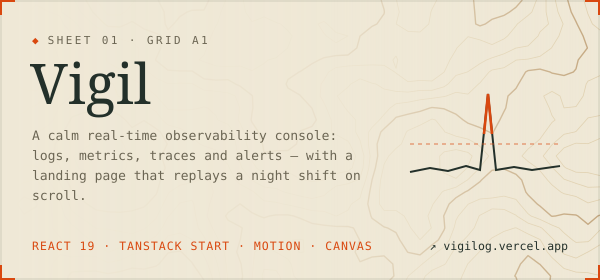
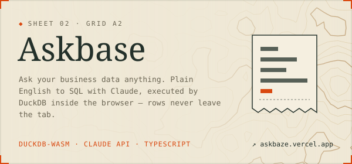
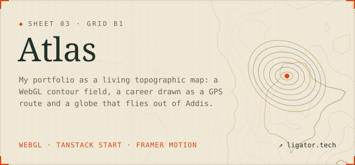
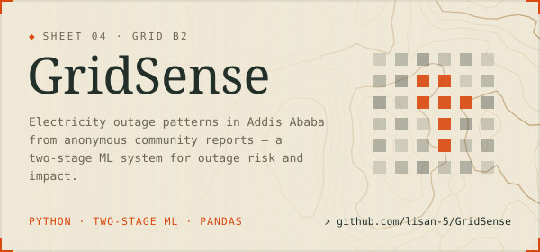
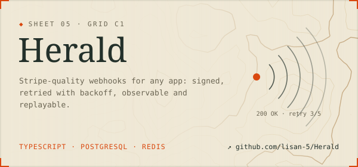
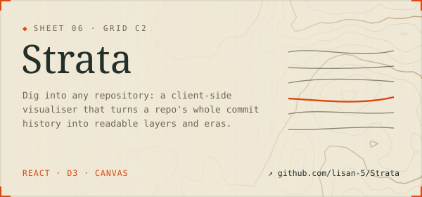
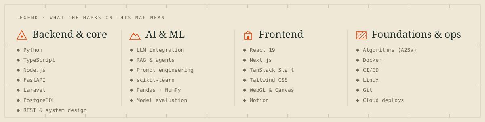

<a href="https://www.ligator.tech">
  <picture>
    <source media="(prefers-color-scheme: dark)" srcset="assets/header-dark.svg">
    
  </picture>
</a>

  <a href="https://www.ligator.tech"><b>Portfolio</b></a> &nbsp;·&nbsp;
  <a href="https://vigilog.vercel.app">Vigil</a> &nbsp;·&nbsp;
  <a href="https://askbaze.vercel.app">Askbase</a> &nbsp;·&nbsp;
  <a href="https://www.linkedin.com/in/lisanegebriel-abay">LinkedIn</a> &nbsp;·&nbsp;
  <a href="mailto:lisan5abay@gmail.com">lisan5abay@gmail.com</a> &nbsp;·&nbsp;
  <a href="https://leetcode.com/u/lisanx/">LeetCode</a> &nbsp;·&nbsp;
  <a href="https://t.me/ligator">Telegram</a>

I build backend systems and the LLM products that sit on them. Right now that's AI automation and async services at **Theseus Group**. Before that I worked on freight routing at **Spotter AI**, a national healthcare platform at **Haddis Art**, and geospatial and routing APIs at **Ambalay Maps** and **Brana** before that. I trained on **A2SV** with 1,000+ algorithm problems, and I care about the last 10% of the UI as much as the first 90% of the API.

**Open to full-stack and AI engineering roles in the US and EU** — remote or relocation.

 

### Landmarks

<table>
  <tr>
    <td width="50%"><a href="https://vigilog.vercel.app"><picture><source media="(prefers-color-scheme: dark)" srcset="assets/landmark-vigil-dark.svg"></picture></a></td>
    <td width="50%"><a href="https://askbaze.vercel.app"><picture><source media="(prefers-color-scheme: dark)" srcset="assets/landmark-askbase-dark.svg"></picture></a></td>
  </tr>
  <tr>
    <td width="50%"><a href="https://www.ligator.tech"><picture><source media="(prefers-color-scheme: dark)" srcset="assets/landmark-atlas-dark.svg"></picture></a></td>
    <td width="50%"><a href="https://github.com/lisan-5/GridSense"><picture><source media="(prefers-color-scheme: dark)" srcset="assets/landmark-gridsense-dark.svg"></picture></a></td>
  </tr>
  <tr>
    <td width="50%"><a href="https://github.com/lisan-5/Herald"><picture><source media="(prefers-color-scheme: dark)" srcset="assets/landmark-herald-dark.svg"></picture></a></td>
    <td width="50%"><a href="https://github.com/lisan-5/Strata"><picture><source media="(prefers-color-scheme: dark)" srcset="assets/landmark-strata-dark.svg"></picture></a></td>
  </tr>
</table>

### The route

<picture>
  <source media="(prefers-color-scheme: dark)" srcset="assets/route-dark.svg">
  
</picture>

### Terrain

<picture>
  <source media="(prefers-color-scheme: dark)" srcset="assets/terrain-dark.svg">
  
</picture>

### Legend

<picture>
  <source media="(prefers-color-scheme: dark)" srcset="assets/legend-dark.svg">
  
</picture>

 

  Every graphic here is hand-built SVG — contours from marching squares over a noise field, no templates. The terrain is drawn from my real contribution calendar. Source in <a href="scripts/build.mjs"><code>scripts/build.mjs</code></a>.

